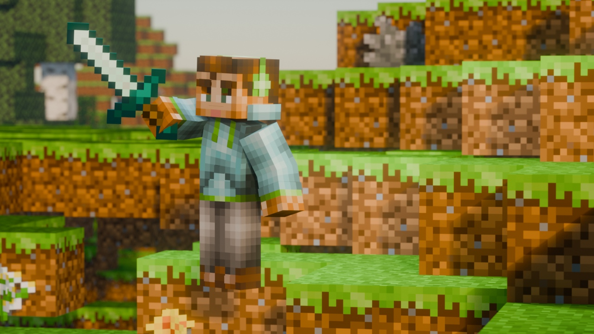
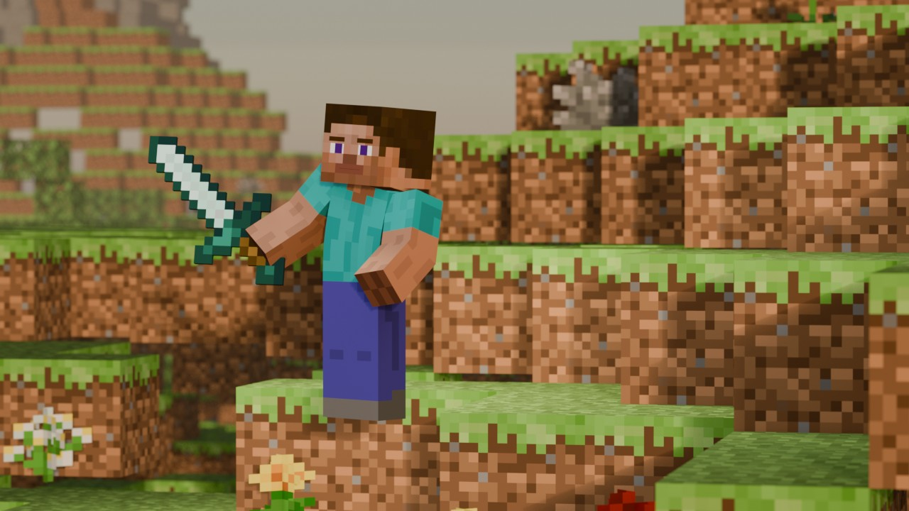
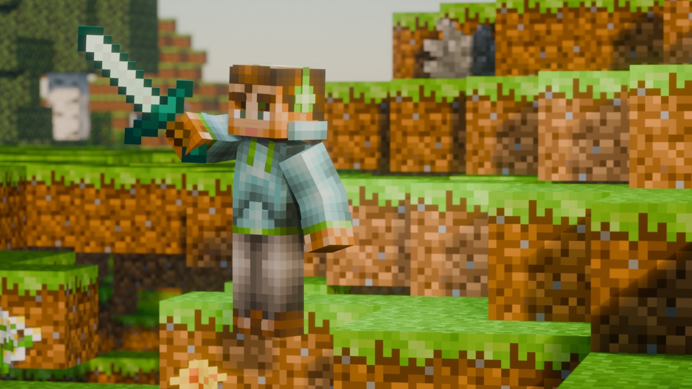

<div align="center">


# dsh-blender-mc

**Turn a Minecraft save into a Blender cover you can ship, or a 10-second clip.**
No Blender skills needed: camera, lighting, materials, grading and the review pass are automatic —
and **it inspects its own render before showing it to you**.

[](LICENSE)
[](https://www.npmjs.com/package/dsh-blender-mc)
[](package.json)
[](py/)
[](https://www.blender.org/)

English · [中文](README.md)

> Maintaining this repo? Read **[docs/交接.md](docs/交接.md)** first (Chinese) — §3 explains
> which of the three source trees is the real one, and why editing `node_modules/dsh-blender-mc`
> without going through the release flow is a trap.

</div>

---

## Result first



> The map and the 64×64 skin were uploaded by the player from **Settings → Background maps**.
> Camera placement, lighting, materials, grading and the review pass are all automatic.
> 1280×720 at 192 samples takes about 16 s on EEVEE.

### 0.4.9 → 0.5.3 — same save, same machine, newer plugin

| 0.4.9 | 0.5.3 |
|---|---|
|  |  |
| Standard view transform, 1.6:1 flat lighting, **no compositor and no contact shadows**; MCprep silently failed, block textures never reached Blender, trees never planted | AgX + three-point lighting re-aimed from the camera + compositor grade (bloom / saturation / vignette) + contact shadows and DoF; texture path fixed; camera picker now rejects azimuths that stare into a dirt wall |

### Beyond a single frame


`mc_anim` (10 s clip), `mc_film` (storyboard → multiple shots → one MP4) and custom motion
recipes (`py/blender/presets/*.json`) reuse the same scene build and the same review pass.

## What it does

| Capability | Details |
|---|---|
| **Automatic camera** | Scans `.mca` regions for flat open ground, scores azimuths (terrain elevation above 8° is out, shooting into the sun is penalised, open space behind the subject scores), then frames the subject left-of-centre with room for a title |
| **Automatic scene** | MCprep materials (with a built-in per-face fallback), BPS v4 character rig, block item library, optional trees that avoid the subject and the camera path |
| **Photographic lighting** | Key / Fill / Rim re-aimed from the camera and the sun direction (world-space fixture lights break as soon as the azimuth changes), golden-hour temperature, physical sky, fog |
| **Cinematic grade** | AgX + compositor: bloom with a threshold derived from the actual frame, saturation, vignette — can be switched off as a whole |
| **Self-review** | OpenCV checks eight things: facing, ground contact, exposure/DR, lighting (ground grey variance), depth of field, framing (subject size / headroom), rim light, sky gradient |
| **Self-correction** | yaw flip, sink depth, sky strength, light multiplier, camera distance; anything else is reported with a score |
| **Clips too** | 10 s animation, storyboard films, your own motion recipes |
| **Your own assets** | Upload map zips and skins from the settings panel; `mc_extract_models` converts Bedrock models from resource packs into OBJ props |

## 30-second start

```bash
# 1) install (or search dsh-blender-mc in the DSH plugin market)
dsh plugin --profile desktop add dsh-blender-mc

# 2) check the environment and assemble Minecraft assets
mc_doctor
mc_setup

# 3) render (the save zip was already uploaded in Settings → Background maps)
mc_shoot { "map": "my-world", "out": "E:/out", "trees": 10 }
```

**It tells you what is missing.** After installation the plugin runs a read-only environment
check in the background (no Blender launch, tens of milliseconds) and caches the result in
`<DSH_HOME>/blender-mc/readiness.json`. If MCprep / cv2 / the rig are missing, the assistant
lists exactly what is missing and how to install each item the next time you talk to it;
when everything is in place it stays silent. Run `mc_doctor` to see the verdict immediately.
Set `startupCheck: 'off'` in the plugin config to disable it (`'cache'` by default, `'full'`
to re-check every time).

---

## Why it's not "just a script"

The hardest part of rendering isn't rendering — it's **not being able to tell
that the render is wrong**.

Real bugs hit while building this:

| Symptom | Actual cause | Time to spot by eye |
|---|---|---|
| "The angle looks wrong" | Character was **facing away** (yaw off by 180°) | several camera tweaks before suspecting the character |
| "Why is he floating?" | Feet **0.019** above ground — MC block edges are razor-sharp | 3 rounds of digging + 3 numeric measurements |
| "What's with the background? There's no light" | `Standard` view transform has no highlight rolloff → physical sky clips to white, dynamic range is consumed | 2 comparison experiments |
| "The sword isn't in his hand" | Wrong grip point (bone tail vs bottom of arm mesh) | per-part measurement |

**All four are detectable by computer vision but invisible in a thumbnail.**

So there's an **OpenCV review pass** after rendering:

| Check | Criterion | Auto-fix |
|---|---|---|
| **Facing** | skin-tone ratio in the head region (front ~30% / back ~9%) | yaw +180° |
| **Ground contact** | colour delta between below-feet and beside-feet ground | increase sink |
| **Exposure** | blown/crushed pixel ratio, dynamic range | lower sky strength |
| **Lighting** | grayscale variance of ground around the subject | raise light multiplier |
| **Composition** | subject height ratio, horizontal position, headroom | adjust camera distance |

### Verified behaviour

Deliberately pass a **wrong facing** (`--yaw -125`, back view):

```
[4/5] render #1 (yaw-125.0°)
[5/5] review: WARN 62
      ⚠️  [1] seeing the BACK (head skin ratio only 8.9%)
      🔧 facing -125.0° → 55.0° (turn to front)
[4/5] render #2 (yaw55.0°)
[5/5] review: PASS 92
      ✅ passed (92 ≥ 85), stop
```

**It found and fixed it on its own.**

---

## Quick start

### Requirements

| | Required | Notes |
|---|---|---|
| ✅ | **Blender** | 4.2 LTS+. [Download](https://www.blender.org/download/) |
| ✅ | **Python 3.10+** | needs `pip` |
| ✅ | **Minecraft Java save** | the folder with `.mca` region files |
| ⭕ | MCprep / BPS rig / item rig / ffmpeg | optional — it tells you exactly what's missing |

> **Bedrock is not supported** — it uses LevelDB; this reads Anvil only.

### Install

```bash
pip install opencv-python numpy
```

Then either install from the DSH plugin marketplace, or:

```bash
git clone https://github.com/TreeCodeTyper/dsh-blender-mc.git
cd dsh-blender-mc
python py/cli.py doctor            # check what's missing
python py/cli.py setup --dry-run   # see what assets would be assembled
python py/cli.py setup             # assemble them
```

Third-party assets (MCprep, rigs, textures) are **not redistributed** — `setup`
copies them from resource folders you already have.

### Commands

```bash
python py/cli.py doctor                              # check requirements
python py/cli.py setup [dirs...] [--dry-run]         # assemble assets
python py/cli.py scan   <save> --area x0,x1,z0,z1    # find camera spots
python py/cli.py shoot  <save> --area ... --out DIR  # render a cover
python py/cli.py anim   <cover.blend> --out DIR      # 10s animation
python py/cli.py check  <images...> [--json]         # review only
```

---

## Contributing

**Only maintainers can push directly. Everyone else: fork → PR → review → merge.**

See **[CONTRIBUTING.md](CONTRIBUTING.md)** (currently Chinese; an English
translation is a very welcome contribution).

The short version:

```bash
git clone https://github.com/<your-github-username>/dsh-blender-mc.git   # your fork
git checkout -b feat/your-feature
# ... edit ...
python py/cli.py doctor && node scripts/smoke.mjs
git commit -m "feat: what you did"
git push origin feat/your-feature
# then open a PR against the upstream repo
```

---

## License

[MIT](LICENSE) — covers this repo's own code and docs.

Runtime third-party assets are **not distributed** by this project;
see [THIRD_PARTY_NOTICES.md](THIRD_PARTY_NOTICES.md).

> Not affiliated with or endorsed by Mojang Studios or Microsoft.
> "Minecraft" is a trademark of Mojang Studios.
