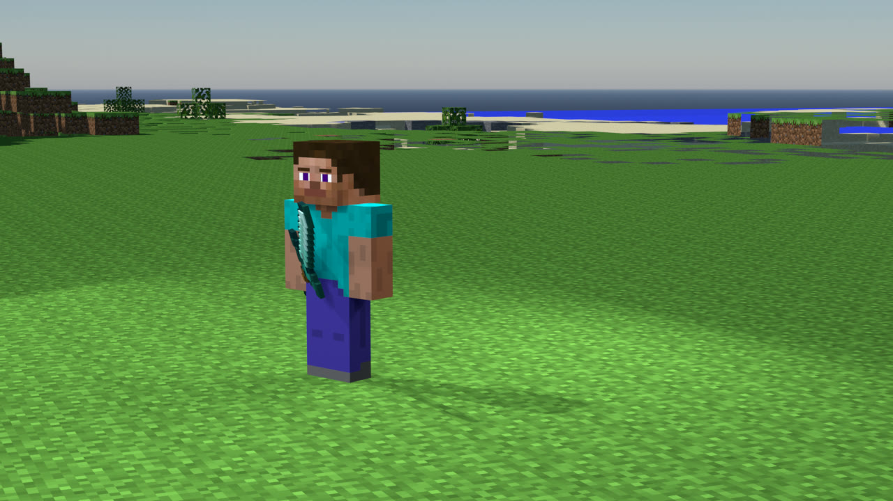
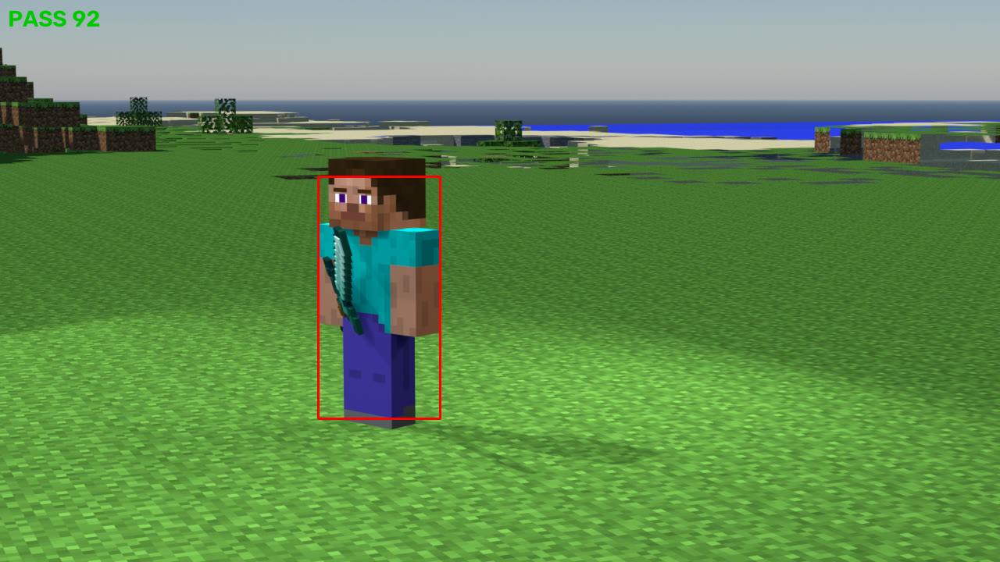
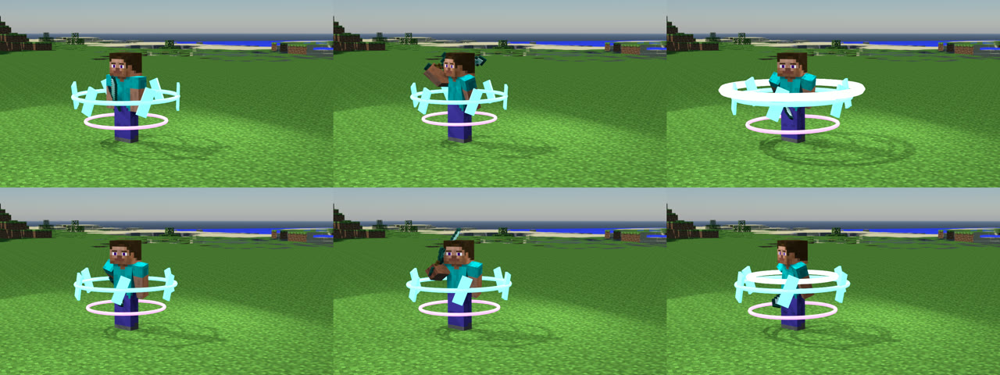

<div align="center">


# dsh-blender-mc

**把 Minecraft 存档变成 Blender 封面和动画。**
你只需要提供存档和 Blender，其余全自动 —— 而且**渲完会自己检查对不对**。

[](LICENSE)
[](package.json)
[](py/)
[](https://www.blender.org/)

[快速开始](#快速开始) · [使用教程](docs/使用教程.md) · [工作原理](#工作原理) · [常见问题](#常见问题) · [参与贡献](CONTRIBUTING.md)

</div>

---

## 这是什么

一个 **DSH 插件**（也可以脱离 DSH 当命令行工具用）。

给它一个 Minecraft 存档目录，它就能：

```
存档 .mca  →  自动找好看的机位  →  导出几何  →  调 Blender 搭场景
           →  渲染  →  ★ OpenCV 自动审图  →  不合格自动调参重渲  →  出图 / 出片
```

你**不用**会 Blender，**不用**会 Mineways，**不用**手动摆相机、调灯光、配材质。

### 出来的封面

真实存档草原 + 海平线，角色 3/4 侧脸持钻石剑。机位、布光、材质全自动。



### 渲完自己审图

每张图渲完都会用 OpenCV 检查 **朝向 / 接地 / 曝光 / 布光 / 构图**，
左上角是结论分数，绿框是识别到的角色位置。不合格会**自动调参重渲**。



### 10 秒动画

挥剑两刀 + 环绕的发光能量环 + 斩击弧光。



### 想换地图？在 DSH 里直接传（0.3.0 新增）

不用再去文件夹里翻存档路径：**设置 → 背景地图**，把整合包的存档 `.zip` 拖进去，
自动解压、自动找出里面的存档、自动读版本和坐标范围、自动生成缩略图。
之后出封面直接说地图名字就行：

> 用「方可梦世界」出一张封面

---

## 为什么不只是"跑个脚本"

因为**手工调试渲染最耗时的不是渲染，是渲完看不出问题**。

这个项目在开发过程中真实踩过的坑：

| 现象 | 实际原因 | 人眼发现耗时 |
|---|---|---|
| "视角好像不对" | 角色**背对镜头**（yaw 差 180°） | 反复调相机 → 才想到是角色朝向 |
| "人咋是悬浮的" | 脚离地 **0.019**，MC 方块边缘锐利，一点缝就显眼 | 三轮排查 + 三次数值测量 |
| "背景咋回事，也没有光源" | 「标准」视图转换无高光压缩，物理天空削顶成白，动态范围被占满 | 两组对比实验 |
| "钻石剑好像没正确握在手上" | 抓握点用错（骨骼尾端 vs 手臂网格底部） | 逐部件测量 |

**这四类问题的共同点：都能被 CV 判出来，但人眼在缩略图上看不出来。**

所以渲染之后加了一道 **OpenCV 审图**：

| 检查项 | 判据 | 不合格自动怎么改 |
|---|---|---|
| **朝向** | 头部区域的皮肤色占比（正面 ~30% / 背面 ~9%） | yaw +180° |
| **接地** | 脚底下方 vs 旁边地面的色差 | 加大下沉量 |
| **曝光** | 死白/死黑像素比、动态范围 | 降天空强度 |
| **布光** | 角色周围地面的灰阶方差（太均匀 = 平光） | 抬灯光倍率 |
| **构图** | 主体占画面高度、水平位置、头顶留白 | 调整相机距离 |

### 实测效果

故意给一个**错的朝向**（`--yaw -125`，背影），看它自己怎么办：

```
[4/5] 第 1 次渲染（yaw-125.0°）
[5/5] 审图: WARN 62 分
      ⚠️  [1] 看到的是【背面】（头部皮肤占比仅 8.9%）
      🔧 角色朝向 -125.0° → 55.0°（转正面）
[4/5] 第 2 次渲染（yaw55.0°）
[5/5] 审图: PASS 92 分
      ✅ 达标（92 ≥ 85），停止迭代
```

**它自己发现并修正了。** 这正是手工调试时最花时间的那一步。

---

## 快速开始

### 第 0 步：需要什么

| | 必需 | 说明 |
|---|---|---|
| ✅ | **Blender** | 4.2 LTS 以上。[下载](https://www.blender.org/download/) |
| ✅ | **Python 3.10+** | 要能 `pip install` |
| ✅ | **Minecraft Java 版存档** | `.mca` 区域文件那层目录 |
| ⭕ | MCprep / BPS 骨架 / 物品库 / ffmpeg | 可选，缺了会**明确告诉你少了什么功能** |

> **基岩版不支持** —— 基岩版用 LevelDB，本项目只读 Anvil 格式。

### 第 1 步：装依赖

```bash
pip install opencv-python numpy
```

### 第 2 步：装插件

**方式 A：从插件市场装（推荐）**

DSH → 设置 → 插件市场 → 搜索 `dsh-blender-mc` → 安装 → **开新会话**

**方式 B：命令行装（推荐给要配本机路径的人）**

```bash
dsh plugin --profile desktop add dsh-blender-mc@0.2.1
python scripts/install_to_profile.py --profile desktop   # 写本机路径配置（可 --dry-run 预览）
```

> **为什么写成 `@0.2.1`**：DSH 装包时有一层「新版本冷却期」（pnpm `minimumReleaseAge`），
> 刚发布几个小时的版本不会自动被选中 —— 不带版本号时可能装到旧的 0.1.2，而那个版本在
> DSH 0.2.0-rc.2 上 7 个工具全都注册不上。写死版本号会绕过冷却期（DSH 会把它记进
> `minimumReleaseAgeExclude`）。等冷却期过了，不带版本号也能装到最新的。

`install_to_profile.py` 会先备份、再改 profile 的 `cordis.patch.yml`，写前用 PyYAML 自查、
写后用 `dsh <profile> --dump-config` 让 DSH 自己组合一遍 —— 这是 0.2.1 修掉的重点，
细节见下面「⚠️ 装完 DSH 打不开怎么办」。

**方式 C：从源码装**

```bash
git clone https://github.com/TreeCodeTyper/dsh-blender-mc.git
cd dsh-blender-mc
python py/cli.py doctor        # 先看看缺什么
```

### ⚠️ 装完 DSH 打不开怎么办（0.2.1 之前的坑）

**症状**：双击 DSH 没反应 / 窗口一闪就没；命令行跑 `dsh` 报
`failed to parse overlay ...\cordis.patch.yml: YAMLException: end of the stream or a document separator is expected`
或 `... must be a top-level YAML array of loader patch entries`。

**原因**：profile 的补丁层 `cordis.patch.yml` 必须**恰好是一份一维 YAML 列表**。
0.2.1 之前的 `scripts/install_to_profile.py` 会直接往文件末尾拼 `- id: blender-mc` 块，
而全新 profile 的模板里那行 `[]` 占位还在 —— `[]` 后面再跟块条目就是一份文档两个顶层元素，
YAML 解析失败 → 补丁层读不出来 → 应用起不来。重装 DSH 能让补丁层退回 `[]` 模板，
所以「只能重装」；但下次再装同一个坑还会踩。

**不用重装的救法**（在 DSH 打不开的状态下也能跑）：

```bash
python scripts/repair_profile.py            # 先体检，看哪个 profile 的补丁层坏了
python scripts/repair_profile.py --apply    # 修（写前自动备份 .bak-<时间戳>）
```

它只做行级修复：把和别人共存的 `[]` 占位注释成 `# []`、文件里一条条目都不剩时补回 `[]`，
然后重启 DSH 即可。修不好也别硬改 —— 把报错贴到
[issues](https://github.com/TreeCodeTyper/dsh-blender-mc/issues)。

> 手工改的话记住两条：① 一个文件里只能有一份顶层列表；② 没有条目时文件里必须留 `[]`，
> 只剩注释会被解析成 `null`，同样起不来。


### 第 3 步：装配外部资产

第三方资产（MCprep、角色骨架、物品库）**不随本项目分发**，需要从你本地已有的资源目录装配：

```bash
python py/cli.py setup --dry-run    # 先看会搬什么，不动文件
python py/cli.py setup              # 实际装配
```

装配器会：

- ✅ 自动优先选 **BPS Rig V4.0.9**（4.0.10 BETA1 的头部网格是平的，会闪烁）
- ✅ 把 **MCprep 解压安装到 Blender 的 addons 目录**（路径是问 Blender 要的）
- ✅ **跳过用不上的大件**（Mineways 251 MB、MCSkin3D —— 本项目直接用 Python 读 `.mca`）
- ✅ **ffmpeg 只记路径不复制**（96 MB 的系统工具没必要再放一份）

### 第 4 步：出图

```bash
python py/cli.py shoot "D:/saves/我的世界" --area -2100,-1600,-1400,-900 --out ./出图
```

`--area` 是允许搜索的矩形范围（`x0,x1,z0,z1`）。不给机位它会自己找。

### 第 5 步（可选）：把你的地图传进 DSH

**DSH → 设置 → 背景地图** → 拖入存档 `.zip`（或点「选择文件」）。

- 单个 zip 上限 **2 GB**，解压后上限 **6 GB** —— 原版整合包地图（几百 MB 到 1 GB）够用
- zip 里套一层文件夹也能认（比如 `方可梦世界/新的世界/level.dat`）
- 一次上传里如果有多个存档，会让你点选要哪一个
- 传完会出现在列表里，带缩略图（能读到 `icon.png` 就用它）、MC 版本、坐标范围；
  三个按钮：**设为默认** / **重命名** / **删除**（删除是软删，文件进回收目录，可找回）

传完就不用记路径了，出图时用 `map` 参数点名：

```jsonc
// mc_shoot
{ "map": "方可梦世界", "out": "E:/出图/方可梦封面" }        // 名字可以写部分前缀
{ "map": "m_542656d4d9e4", "out": "..." }                  // 也可以写 map id
```

`map` 省掉两个必填参数：`save`（自动指向解压出来的存档目录）和 `area`
（自动按存档包围盒推荐机位搜索范围）。想自己指定范围，照旧写 `area` 覆盖它。

命令行等价写法（不经过 DSH 面板）：

```bash
# 导入一个 zip（--root 默认 %USERPROFILE%\.dsh\blender-mc\maps）
python py/cli.py map import --zip D:/整合包/方可梦世界.zip --name 方可梦世界
python py/cli.py map list
python py/cli.py map resolve --name 方可梦        # 打印 savePath / area / 版本
```

数据都在 `%USERPROFILE%\.dsh\blender-mc\maps\` 下，一个地图一个目录，删插件不删地图。

---

## 使用教程

**第一次用请看 → [手把手使用教程](docs/使用教程.md)**
（从找存档目录开始，到出封面、出动画、调参，每步都有截图级说明）

### 命令速查

```bash
# 检查运行条件（缺什么会给出完整安装指引）
python py/cli.py doctor

# 装配外部资产
python py/cli.py setup [资源目录...] [--dry-run]

# 提取你自己资源包里的模型（Bedrock 几何 → OBJ，插件不带任何素材）
python py/cli.py extract <资源目录> --out <目录> [--list] [--filter 关键词]

# 在存档里找机位（按「开阔度」排序）
python py/cli.py scan <存档> --area x0,x1,z0,z1

# 出封面（含审图闭环）
python py/cli.py shoot <存档> --area x0,x1,z0,z1 --out <目录>

# 出动画（默认 10 秒杀戮光环）
python py/cli.py anim <封面工程.blend> --out <目录> [--preview 1,60,120]

# 只审图，不跑 Blender
python py/cli.py check <图...> [--json]

# 地图库：把存档 zip 收进来（DSH 面板做的是同一件事）
python py/cli.py map import --zip <存档.zip> [--name 名字]
python py/cli.py map list | resolve --name <名字> | rename | delete | default | doctor
```

### 在 DSH 里直接用

装好插件后开新会话，直接用自然语言：

> 用 `E:\存档\我的世界` 出一张封面，背景要开阔点的

> 先 doctor 看看环境齐不齐

> 把出好的封面做成 10 秒动画

> 用我上传的「方可梦世界」出三张不同机位的封面

模型会自己判断该调哪个工具（`mc_doctor` / `mc_extract_models` / `mc_scan` / `mc_shoot` / `mc_anim` / `mc_check`）。
上传过的地图可以直接用 `map` 参数点名（见[第 5 步](#第-5-步可选把你的地图传进-dsh)），不用报路径。

### 自带模型（可选）

插件**不附带任何模型或贴图**。要把自己的模型摆进封面，三步：

```bash
# ① 提取：把你的资源包里的 Bedrock 几何转成 OBJ（先 --list 看会转什么）
python py/cli.py extract "D:\资源包解包目录" --out .\模型 --filter barrel

# ② 指路径：描述文件（数量不限）或三个槽位环境变量
$env:DSH_MODELS = "D:\模型\models.json"
# 或 $env:DSH_MODEL1_OBJ / _TEX / _SCALE / _BACK / _SIDE / _Z / _YAW

# ③ 正常出图，模型会按参数站在场景里
python py/cli.py shoot "D:/saves/我的世界" --area -2100,-1600,-1400,-900 --out ./出图
```

细节（参数表、常见问题、授权注意）见 **[自带模型](docs/自带模型.md)**。

### 常用参数

| 参数 | 默认 | 说明 |
|---|---|---|
| `--yaw` | 25 | 角色朝向（度）。相机在 -Y，25° 是 3/4 侧脸面向镜头 |
| `--cam-az` | 200 | 视线方位角（MC 角度） |
| `--dist` | 11.2 | 相机距离 |
| `--sky` | 0.03 | 天空强度。**用「标准」视图转换时必须 ≤0.05**，否则削顶成白 |
| `--sink` | 0.06 | 脚陷入地面的深度。防止"看起来悬浮" |
| `--view-transform` | Standard | `Standard` / `Filmic` / `AgX` |
| `--attempts` | 3 | 审图不达标时自动重渲几轮 |
| `--target` | 85 | 目标分，达到就停 |

---

## 工作原理

```
① scan     读 .mca → 每列最高方块 → 找成片同高度平地 → 排除视线遮挡 → 推荐机位
② export   机位周围导出 OBJ（材质名 = MC 贴图名，供 MCprep 识别）
③ build    调 Blender：导入世界 → mcprep.prep_materials（含生物群系染色）
           → 追加角色集合 → 手持物品挂 Hand.R → 自带模型落位 → 物理天空 → 三点布光 → 相机
④ render   EEVEE 渲染
⑤ check    OpenCV 审图 → 不合格回 ③ 改参数（最多 N 轮）
⑥ anim     （可选）骨骼关键帧 + 旋转光环 + 斩击弧光
⑦ convert  ffmpeg 转 MP4 / GIF
```

> 自带模型走的是独立支线：`extract`（Bedrock 几何 → OBJ，`py/bedrock.py`）
> → `build` 阶段按 `DSH_MODELS` / `DSH_MODEL1_*` 落位。

### 目录结构

```
dsh-blender-mc/
├── lib/index.js              DSH 插件外壳：注册 7 个工具，调 Python
├── py/
│   ├── cli.py                命令行入口
│   ├── pipeline.py           ★ 编排 + 审图闭环 + auto_adjust
│   ├── vision_check.py       ★ OpenCV 审图
│   ├── bedrock.py            Bedrock 几何（.geo.json）→ OBJ
│   ├── extract.py            批量提取模型 + 猜贴图 + 写清单
│   ├── model_spec.py         自带模型的入参解析（DSH_MODELS / DSH_MODEL1_*）
│   ├── requirements.py       运行条件检查 + 安装指引
│   ├── setup_assets.py       外部资产装配
│   ├── scan.py               找机位
│   ├── anvil.py              读 .mca（纯标准库，不需要 Blender）
│   └── blender/
│       ├── _compat.py        ★ Blender 版本兼容层
│       ├── export_obj.py     存档 → OBJ
│       ├── build_cover.py    搭场景 + 渲染（含自带模型落位）
│       └── animate_aura.py   杀戮光环动画
├── docs/                     使用教程 / 自带模型 / 发布指南
└── vendor/                   ← 装配出来的第三方资产（.gitignore 排除）
```

### 设计取舍

**JS 侧只做「工具注册 + 参数校验 + 调 Python + 汇报」，真正的活全在 `py/` 里。**
这样用户能在命令行直接跑同一套逻辑，不必依赖 DSH 才能用。

**每个非直觉的判断在代码里都标了 `⚠️ 坑 N`**，写明报什么错、为什么错、正确判据是什么。
比如：

| 坑 | 内容 |
|---|---|
| 版本兼容 | Blender 4.4 起 `Action` 没有 `.fcurves`；5.2 把天空 `NISHITA` 改名 |
| Windows | `cv2.imread` **不支持中文路径**，必须走 `imdecode` |
| 求值 | `o.bound_box` **不算修改器形变**，拿它算落地角色会浮在半空 |
| 过滤 | 判断"哪些网格算身体"错了四次，最终判据是「有 Armature 修改器 **且未隐藏**」 |
| 扫描 | 扫描范围外的格子**必须当作有东西**，否则会选出被房子包围的假阳性机位 |

---

## 常见问题

<details>
<summary><b>缺东西怎么办？</b></summary>

跑 `python py/cli.py doctor`。**缺任何东西都会给出完整安装指引**，包含：
是什么 / 没它会怎样 / 去哪下载 / 怎么装 / 怎么验证。

必需项（Python 依赖、Blender、MCprep）缺了会拦住并停下；
可选项（角色骨架、物品库、贴图、ffmpeg）缺了只提示，**会降级继续跑**：
没有角色骨架就出风景空镜，没有 ffmpeg 就只出帧序列。

</details>

<details>
<summary><b>渲出来草地是灰白的？</b></summary>

MCprep 没装或没启用。草和树叶的贴图本身是**灰度的**，绿色是运行时按生物群系乘上去的
—— 这一步由 MCprep 完成。

</details>

<details>
<summary><b>动画渲了多少帧、怎么转视频？</b></summary>

`mc_anim` 出的是 PNG 序列帧。转 MP4：

```bash
ffmpeg -framerate 24 -i frame_%04d.png -c:v libx264 -crf 18 \
       -pix_fmt yuv420p -movflags +faststart 输出.mp4
```

`sink` 那类参数、以及为什么建议**先 `--preview 1,60,120` 只渲几帧**验证动作，
见[使用教程](docs/使用教程.md)。

</details>

<details>
<summary><b>支持基岩版吗？</b></summary>

不支持。基岩版用 LevelDB 存储，本项目只读 Java 版的 Anvil 格式（`.mca`）。

</details>

<details>
<summary><b>为什么外部资产不打包进来？</b></summary>

因为它们**全是别人的作品**（MCprep 是 GPL、BPS Rig 属 BlenderPlasticStudio、
MC 素材是 Mojang 的），各有各的许可，再分发不合适。

而且大部分用不上：Mineways 251 MB、Cycles Rig 整包 551 MB（实际只用其中 1 个 15.7 MB 的文件）。
本项目用纯 Python 直接读 `.mca`，**不需要 Mineways 那套 GUI 导出流程**。
所以改成从你本地已有的资源目录"装配"，`vendor/` 也排除在版本库和 npm 包之外。

</details>

---

## 参与贡献

**欢迎贡献，但请走 fork → PR → 审核 → 合并的流程。**
直接推送到源仓库是不允许的。

完整流程见 **[CONTRIBUTING.md](CONTRIBUTING.md)**。简要版：

```bash
# 1. 先 fork，再克隆你自己的 fork
git clone https://github.com/<你的 GitHub 用户名>/dsh-blender-mc.git
cd dsh-blender-mc

# 2. 建分支（不要直接在 main 上改）
git checkout -b feat/你的功能名

# 3. 改完自测
python py/cli.py doctor
python py/cli.py check <几张你渲出来的图>
node scripts/smoke.mjs

# 4. 提交并推送
git commit -m "feat: 做了什么"
git push origin feat/你的功能名

# 5. 在 GitHub 上对源仓库开 Pull Request
```

**所有 PR 都需要通过维护者审核后才能合并。**

### 特别欢迎的贡献

- 🌍 **英文文档 / 其他语言** —— 现在只有中文
- 🎬 **更多动画预设** —— 现在只有"杀戮光环"一种
- 👁️ **更多审图判据** —— 比如"主体是否被前景遮挡"
- 🧱 **更多方块 / 物品支持** —— 或者 MiBlend 的接入
- 🐛 **你踩到的坑** —— 带上复现步骤和报错原文，非常有价值

### 提交前请确认

- [ ] `python py/cli.py doctor` 通过
- [ ] 新加的判据/参数在代码注释里写清了**为什么**（不只写"做了什么"）
- [ ] 没有把 `vendor/` 或渲染产物提交进去
- [ ] 改了行为就更新 `CHANGELOG.md`

---

## 许可

[MIT](LICENSE) —— 覆盖本仓库自身的代码与文档。

运行时需要的第三方资产**不由本项目分发**，详见 [THIRD_PARTY_NOTICES.md](THIRD_PARTY_NOTICES.md)。

**模型与贴图同理**：插件只提供格式转换和摆放能力，不带任何模型 / 贴图，
也不内置任何作品名。你用自己的素材进场景，素材授权请自行确认
（见 [自带模型 · 授权与合规](docs/自带模型.md#授权与合规)）。

> 本项目与 Mojang Studios、Microsoft 无任何隶属或背书关系。
> "Minecraft" 是 Mojang Studios 的商标。

<div align="center">
<sub>如果这个项目帮你省下了调相机的时间，点个 ⭐ 吧</sub>
</div>
